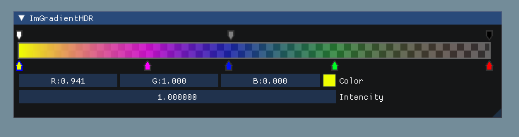

# ImGradientHDR



## 日本語

Dear ImGui用のHDRグラデーション編集ウィジェットです。色・アルファ・強度を編集できます。

### ビルドとテスト

CMake 3.15以上、C++14コンパイラー、Gitを使用します。
単独ビルドではDear ImGui v1.91.9bとGLFW 3.4を初回構成時に取得します。
サンプルにはOpenGLとウィンドウ環境が必要です。LinuxではGLFW用のX11／Wayland開発パッケージも必要です。

Windows（Visual Studio 2022）の例:

```powershell
cmake -S . -B build -G "Visual Studio 17 2022" -A x64
cmake --build build --config Debug --parallel
cd build
ctest -C Debug --output-on-failure
.\Debug\ImGradientHDRExample.exe
```

Linux／macOSの単一構成Generatorの例:

```sh
cmake -S . -B build -DCMAKE_BUILD_TYPE=Debug
cmake --build build --parallel
cd build
ctest --output-on-failure
./ImGradientHDRExample
```

Releaseを使う場合は上記のDebugをReleaseへ置き換えます。
サンプルに`--smoke-test`を指定すると、非表示ウィンドウで3フレーム描画して終了します。
この確認にも利用可能なOpenGL環境が必要で、マウス操作や見た目の一致までは検証しません。
通常起動では色・アルファのキーを追加・移動し、選択したキーの値や強度、削除を確認できます。

| CMakeオプション | 単独ビルド時の既定値 | 用途 |
|---|---|---|
| `IMGRADIENTHDR_BUILD_EXAMPLE` | ON | GLFW／OpenGLサンプル |

サンプルをOFFにするとOpenGL・GLFWは不要です。
取得済みソースを使う場合は、FetchContent標準の`FETCHCONTENT_SOURCE_DIR_IMGUI`・`FETCHCONTENT_SOURCE_DIR_GLFW`へ絶対パスを指定できます。

### 他のプロジェクトへの組み込み

`add_subdirectory`で追加し、`ImGradientHDR::ImGradientHDR`へリンクします。
サンプルとテストは組み込み時には既定でOFFです。
既存の`imgui`ターゲットがあれば再利用し、なければ固定版を取得します。
既存ターゲットを使ってサンプルもビルドする場合は、Backendソースの場所を`imgui_SOURCE_DIR`で指定してください。

---

## English

An HDR gradient editor widget for Dear ImGui, supporting color, alpha, and intensity.

### Build and test

Requires CMake 3.15 or newer, a C++14 compiler, and Git.
Standalone configuration fetches Dear ImGui v1.91.9b and GLFW 3.4 on first use.
The example requires OpenGL and a window system. Linux also needs GLFW's X11/Wayland development packages.

Windows example (Visual Studio 2022):

```powershell
cmake -S . -B build -G "Visual Studio 17 2022" -A x64
cmake --build build --config Debug --parallel
cd build
ctest -C Debug --output-on-failure
.\Debug\ImGradientHDRExample.exe
```

Linux/macOS example with a single-configuration generator:

```sh
cmake -S . -B build -DCMAKE_BUILD_TYPE=Debug
cmake --build build --parallel
cd build
ctest --output-on-failure
./ImGradientHDRExample
```

Replace Debug with Release for release builds.
Pass `--smoke-test` to the example to render three frames in a hidden window and exit.
This still requires a working OpenGL environment and does not verify mouse interactions or visual equivalence.
Run normally to add/move color and alpha keys, edit selected values/intensity, and delete keys.

| CMake option | Standalone default | Purpose |
|---|---|---|
| `IMGRADIENTHDR_BUILD_EXAMPLE` | ON | GLFW/OpenGL example |

Disabling the example removes the OpenGL/GLFW requirement.
To use existing source checkouts, set FetchContent's standard `FETCHCONTENT_SOURCE_DIR_IMGUI` and `FETCHCONTENT_SOURCE_DIR_GLFW` to absolute paths.

### Embedding

Use `add_subdirectory` and link to `ImGradientHDR::ImGradientHDR`.
Examples and tests default to OFF when embedded.
An existing `imgui` target is reused; otherwise the pinned version is fetched.
To build the example with an existing target, set `imgui_SOURCE_DIR` to locate its backend sources.

